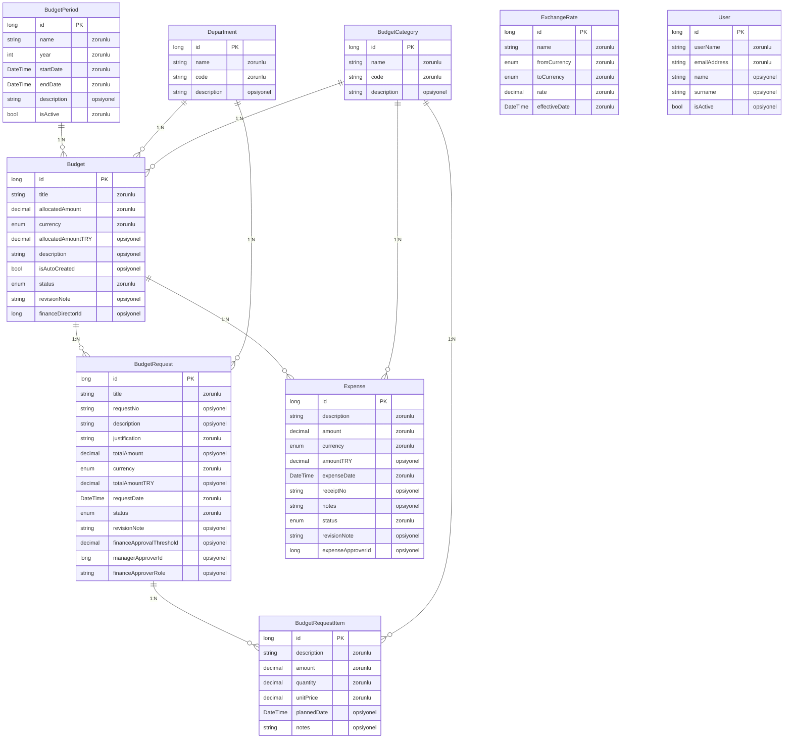
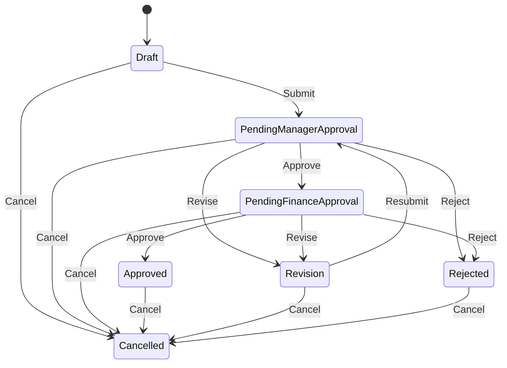
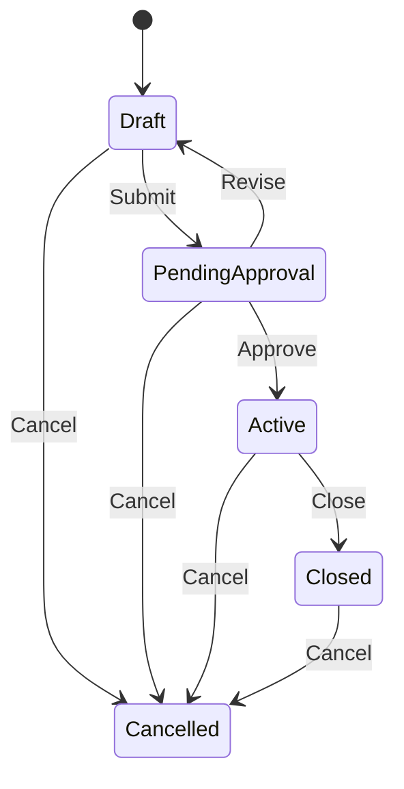
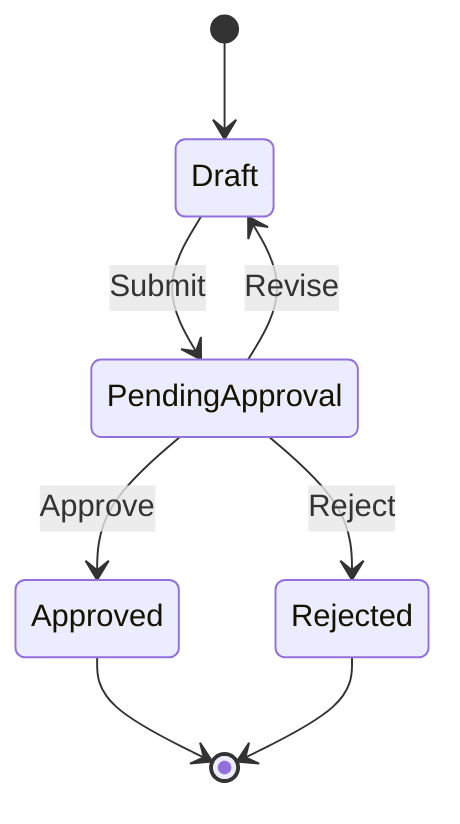
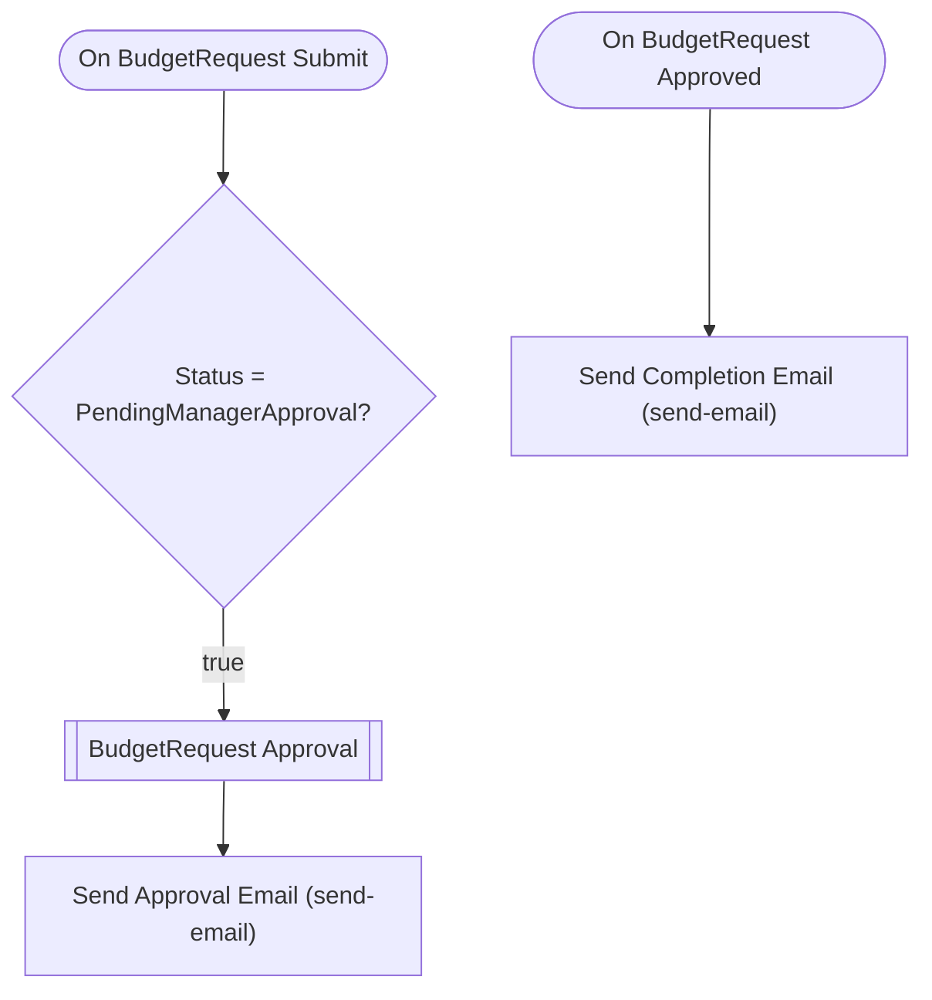
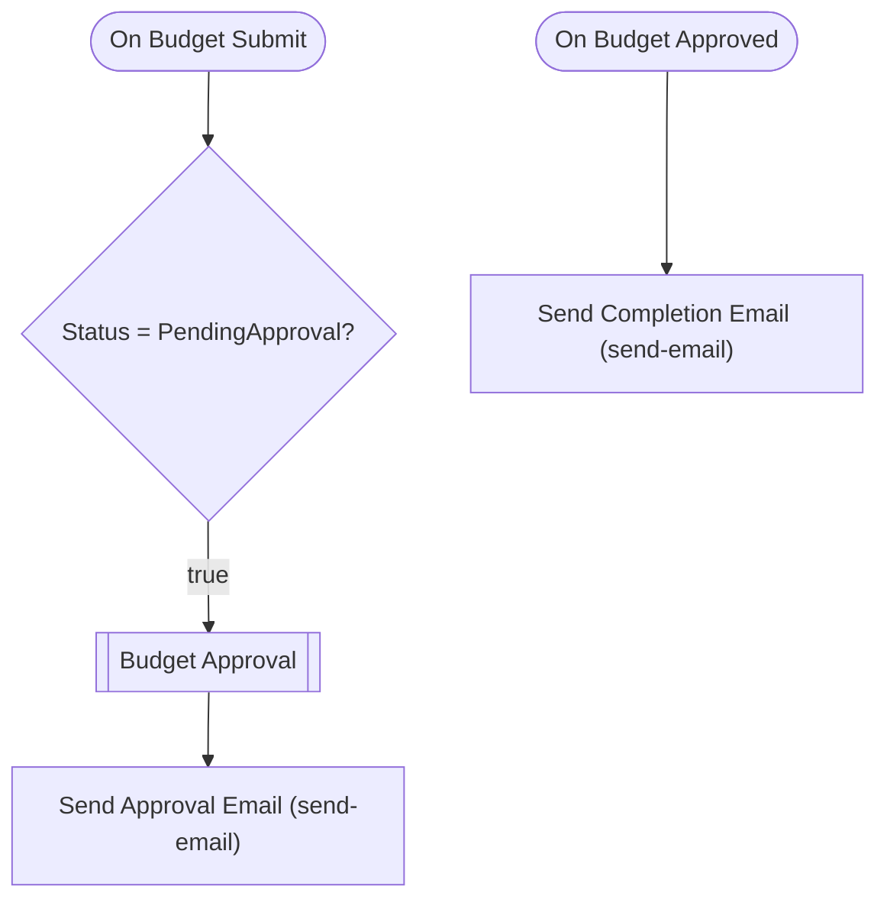
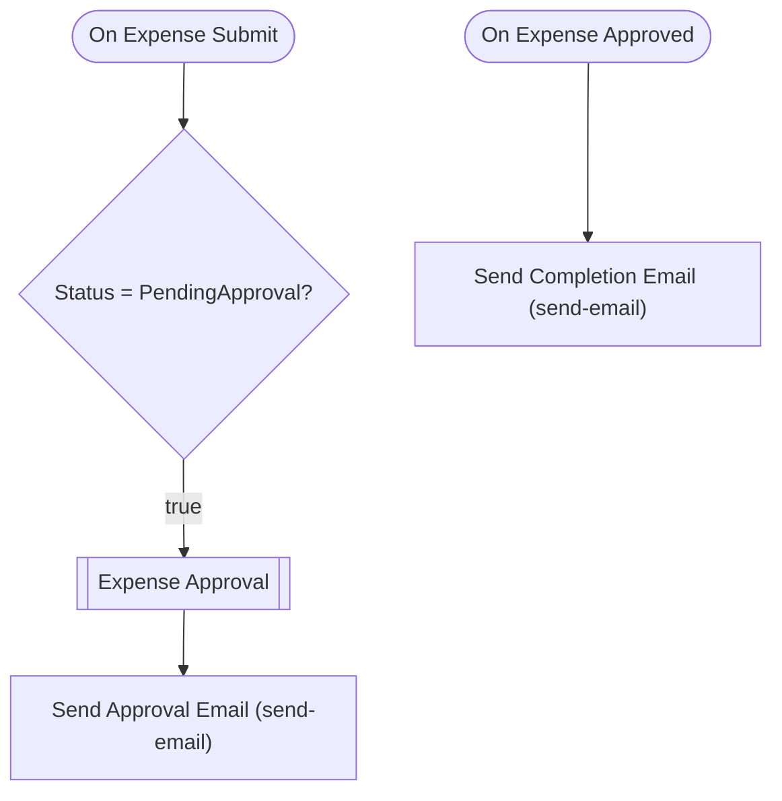

# bütçe-yönetimi — Talep Analizi

> Bu belge Archipid talep olgunlaştırma (discovery) akışıyla üretildi.

## Orijinal Talep

bir bütçe yönetimi uygulaması istiyorum

## Özet

Bütçe Yönetimi uygulaması, departmanların bütçe taleplerini oluşturmasına, bunları yönetici ve (belirli bir tutar eşiğinin üzerindeyse) finans onayından geçirmesine, onaylanan bütçelere karşı yapılan harcamaları kayıt altına almasına ve tüm bu süreci farklı para birimleriyle merkezi bir ekrandan takip etmesine olanak tanır.

Çalışan bir bütçe talebi oluşturur, kalemlerini ve TL karşılıklarını girer; talep önce yöneticiye iletilir. Yönetici onayladıktan sonra, toplam tutar belirlenen eşiği aşıyorsa finans ekibine de düşer; eşiğin altındaysa finans adımı atlanır ve talep doğrudan onaylanır. Revize istenirse form oluşturana geri döner. Onaylanan talepten yola çıkarak finans uzmanı bir bütçe kaydı oluşturur; finans direktörü bu bütçeyi onaylar ve aktive eder. Bütçeye bağlı harcamalar girilir ve harcama onayı alınır; onaylanan harcama kaydı kilitlenir ve değiştirilemez. Uygulama farklı para birimlerini (TRY, USD, EUR) destekler; kurlar ExchangeRate tablosunda tutulur ve TL karşılıkları formda belirtilir.

## Kapsam

- (belirtilmedi)

## Kapsam Dışı

- (belirtilmedi)

## Açık Noktalar

- (belirtilmedi)

## Eksiklikler

- (belirtilmedi)

## Öneriler

- (belirtilmedi)

## Veri Modeli

### BudgetPeriod — Bütçe Dönemi

| Alan | Tip | Zorunlu | Uzunluk |
|---|---|---|---|
| `id` | long | Evet | — |
| `name` | string | Evet | 200 |
| `year` | int | Evet | — |
| `startDate` | DateTime | Evet | — |
| `endDate` | DateTime | Evet | — |
| `description` | string | Hayır | 1000 |
| `isActive` | bool | Evet | — |

**Neye bağlı:** Budget (1:N, bu tablo "bir" tarafı)

### Department — Departman

| Alan | Tip | Zorunlu | Uzunluk |
|---|---|---|---|
| `id` | long | Evet | — |
| `name` | string | Evet | 200 |
| `code` | string | Evet | 50 |
| `description` | string | Hayır | 1000 |

**Neye bağlı:** Budget (1:N, bu tablo "bir" tarafı) · BudgetRequest (1:N, bu tablo "bir" tarafı)

### BudgetCategory — Bütçe Kategorisi

| Alan | Tip | Zorunlu | Uzunluk |
|---|---|---|---|
| `id` | long | Evet | — |
| `name` | string | Evet | 200 |
| `code` | string | Evet | 50 |
| `description` | string | Hayır | 500 |

**Neye bağlı:** Budget (1:N, bu tablo "bir" tarafı) · BudgetRequestItem (1:N, bu tablo "bir" tarafı) · Expense (1:N, bu tablo "bir" tarafı)

### ExchangeRate — Döviz Kuru

| Alan | Tip | Zorunlu | Uzunluk |
|---|---|---|---|
| `id` | long | Evet | — |
| `name` | string | Evet | 100 |
| `fromCurrency` | enum (TRY,USD,EUR) | Evet | — |
| `toCurrency` | enum (TRY,USD,EUR) | Evet | — |
| `rate` | decimal | Evet | — |
| `effectiveDate` | DateTime | Evet | — |

**Neye bağlı:** bağımsız tablo

### BudgetRequest — Bütçe Talebi

| Alan | Tip | Zorunlu | Uzunluk |
|---|---|---|---|
| `id` | long | Evet | — |
| `title` | string | Evet | 300 |
| `requestNo` | string | Hayır | 50 |
| `description` | string | Hayır | 2000 |
| `justification` | string | Evet | 2000 |
| `totalAmount` | decimal | Hayır | — |
| `currency` | enum (TRY,USD,EUR) | Evet | — |
| `totalAmountTRY` | decimal | Hayır | — |
| `requestDate` | DateTime | Evet | — |
| `status` | enum (Draft,PendingManagerApproval,PendingFinanceApproval,Approved,Revision,Rejected,Cancelled) | Evet | — |
| `revisionNote` | string | Hayır | 1000 |
| `financeApprovalThreshold` | decimal | Hayır | — |
| `managerApproverId` | long | Hayır | — |
| `financeApproverRole` | string | Hayır | — |

**Neye bağlı:** Budget (1:N, bu tablo "çok" tarafı) · BudgetRequestItem (1:N, bu tablo "bir" tarafı) · Department (1:N, bu tablo "çok" tarafı)

### BudgetRequestItem — Bütçe Talep Kalemi

| Alan | Tip | Zorunlu | Uzunluk |
|---|---|---|---|
| `id` | long | Evet | — |
| `description` | string | Evet | 500 |
| `amount` | decimal | Evet | — |
| `quantity` | decimal | Evet | — |
| `unitPrice` | decimal | Evet | — |
| `plannedDate` | DateTime | Hayır | — |
| `notes` | string | Hayır | 500 |

**Neye bağlı:** BudgetRequest (1:N, bu tablo "çok" tarafı) · BudgetCategory (1:N, bu tablo "çok" tarafı)

### Budget — Bütçe

| Alan | Tip | Zorunlu | Uzunluk |
|---|---|---|---|
| `id` | long | Evet | — |
| `title` | string | Evet | 300 |
| `allocatedAmount` | decimal | Evet | — |
| `currency` | enum (TRY,USD,EUR) | Evet | — |
| `allocatedAmountTRY` | decimal | Hayır | — |
| `description` | string | Hayır | 1000 |
| `isAutoCreated` | bool | Hayır | — |
| `status` | enum (Draft,PendingApproval,Active,Closed,Cancelled) | Evet | — |
| `revisionNote` | string | Hayır | 1000 |
| `financeDirectorId` | long | Hayır | — |

**Neye bağlı:** BudgetPeriod (1:N, bu tablo "çok" tarafı) · Department (1:N, bu tablo "çok" tarafı) · BudgetCategory (1:N, bu tablo "çok" tarafı) · BudgetRequest (1:N, bu tablo "bir" tarafı) · Expense (1:N, bu tablo "bir" tarafı)

### Expense — Harcama

| Alan | Tip | Zorunlu | Uzunluk |
|---|---|---|---|
| `id` | long | Evet | — |
| `description` | string | Evet | 500 |
| `amount` | decimal | Evet | — |
| `currency` | enum (TRY,USD,EUR) | Evet | — |
| `amountTRY` | decimal | Hayır | — |
| `expenseDate` | DateTime | Evet | — |
| `receiptNo` | string | Hayır | 100 |
| `notes` | string | Hayır | 1000 |
| `status` | enum (Draft,PendingApproval,Approved,Rejected) | Evet | — |
| `revisionNote` | string | Hayır | 500 |
| `expenseApproverId` | long | Hayır | — |

**Neye bağlı:** Budget (1:N, bu tablo "çok" tarafı) · BudgetCategory (1:N, bu tablo "çok" tarafı)

### User — Kullanıcı (Sistem)

| Alan | Tip | Zorunlu | Uzunluk |
|---|---|---|---|
| `id` | long | Evet | — |
| `userName` | string | Evet | 64 |
| `emailAddress` | string | Evet | 256 |
| `name` | string | Hayır | 128 |
| `surname` | string | Hayır | 128 |
| `isActive` | bool | Hayır | — |

**Neye bağlı:** bağımsız tablo

## İş Akışları

### Bütçe Talebi — durum makinesi

**Onay adımları**

| # | Adım | Atanan | Aksiyonlar | Zorunlu alanlar |
|---|---|---|---|---|
| 1 | Yönetici Onayı | Alan: `managerApproverId` | Onayla (approve), Revize Et (revise) | `revisionNote` |
| 2 | Finans Onayı | Alan: `financeApproverRole` | Onayla (approve), Revize Et (revise) | `revisionNote` |

Reddedilirse kayıt **`Revision`** durumuna döner.

### Bütçe — durum makinesi

**Onay adımları**

| # | Adım | Atanan | Aksiyonlar | Zorunlu alanlar |
|---|---|---|---|---|
| 1 | Finans Direktörü Onayı | Alan: `financeDirectorId` | Onayla (approve), Revize Et (revise) | `revisionNote` |

Reddedilirse kayıt **`Draft`** durumuna döner.

### Harcama — durum makinesi

**Onay adımları**

| # | Adım | Atanan | Aksiyonlar | Zorunlu alanlar |
|---|---|---|---|---|
| 1 | Harcama Onayı | Alan: `expenseApproverId` | Onayla (approve) | — |

Reddedilirse kayıt **`Draft`** durumuna döner.

### Akış: BudgetRequest Approval Flow

Auto-generated approval flow for BudgetRequest. Customize email templates and add conditions as needed.

### Akış: Budget Approval Flow

Auto-generated approval flow for Budget. Customize email templates and add conditions as needed.

### Akış: Expense Approval Flow

Auto-generated approval flow for Expense. Customize email templates and add conditions as needed.

## Elle Geliştirme Gerektirenler

Aşağıdaki maddeler senaryonun gereği ama üretilen koda yansımıyor — kod yazılması gerekir.

| Alan | İş | Neden | Geçici çözüm |
|---|---|---|---|
| validation | Harcama vs. tahsis kıyaslaması (bütçe aşımı kontrolü) | Toplam harcamanın tahsis edilen bütçeyi aşıp aşmadığını karşılaştıran iş kuralı üretilemiyor; alan bazlı doğrulama yalnızca zorunluluk/uzunluk destekliyor. | Finans uzmanı onay sırasında dashboard'daki harcama toplamını manuel olarak kontrol etsin. |
| entity | Talep numarası otomatik üretimi | SAT-2025-0001 formatında otomatik sequence/numara üretimi desteklenmiyor. | requestNo alanı kullanıcı tarafından girilir. |
| flow | Onaylanan bütçe talebinden otomatik Bütçe kaydı oluşturulması | Kayıt onaylanınca başka bir entity'de otomatik kayıt oluşturma (cross-entity flow) desteklenmiyor. | Finans uzmanı, talebi onayladıktan sonra ilgili bütçe kaydını manuel olarak oluşturur ve Budget.isAutoCreated alanını işaretler. BudgetRequest → Budget ilişkisi manuel kurulur. |
| entity | Döviz kuru ile TL karşılığı otomatik hesaplama | Tutar alanı ile döviz kuru tablosundan çekilen verinin çarpımıyla otomatik TL karşılığı hesaplayan formül üretilemiyor. | totalAmountTRY ve amountTRY alanları kullanıcı tarafından manuel girilir; ExchangeRate tablosu referans olarak tutulur. |
| entity | Onaylanan harcama kaydının kilitlenmesi | Terminal duruma geçince form kilitlenmesi (readonly) üretilen koda yansımıyor; form her durumda düzenlenebilir. | Approved ve Rejected durumlarından çıkış geçişi tanımlanmamıştır; bu nedenle terminal durumdaki kayıtlar üzerinde durum değiştirme mümkün olmaz. Alan bazlı düzenleme kısıtı uygulanamaz. |
| approval | Finans onay eşiği — sistem genelinde sabit eşik | Finans onay adımının koşulu (totalAmountTRY > 50000) modele sabit değer olarak yazıldı. Eşik değeri uygulama ayarlarından dinamik olarak çekilemiyor. | Eşik değeri değişirse approval step condition'ı geliştirici tarafından güncellenmeli. |
